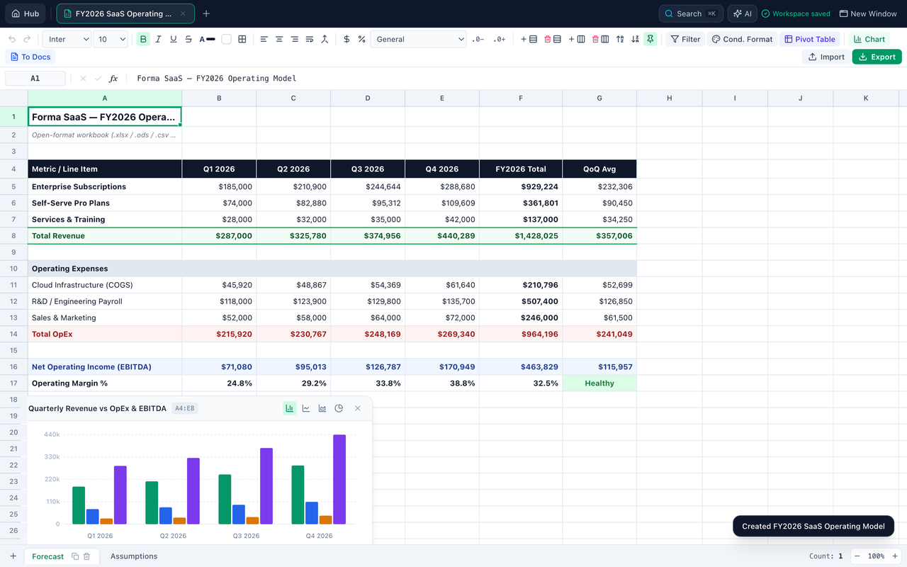
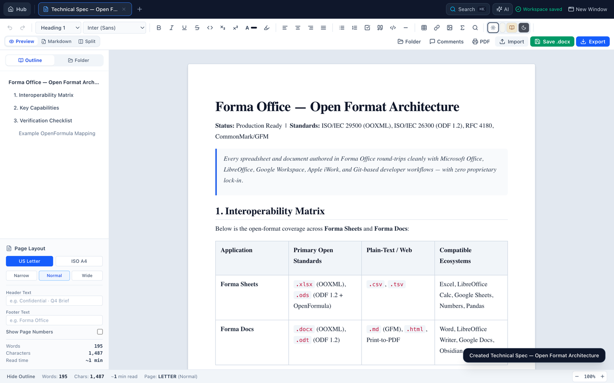
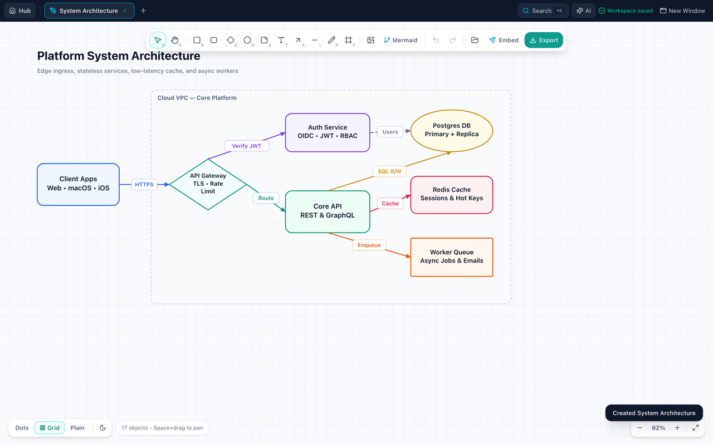
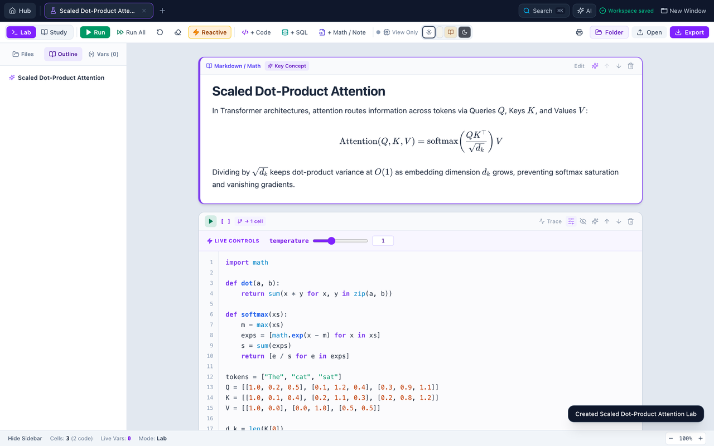
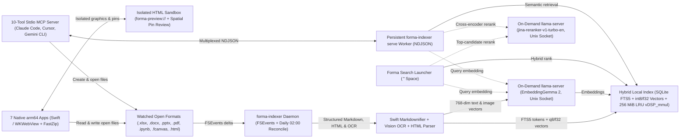
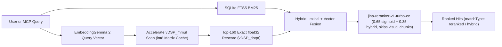

# Forma Office

An open-format, local-first office, scientific notebook, whiteboard, and multimodal AI search suite compiled into **seven lightweight native macOS (`arm64`) applications** (~8.7 MB per suite app, 1.8 MB menu bar launcher — zero Electron).

Forma keeps your documents strictly on your Mac in standard open formats (`.xlsx`, `.docx`, `.pptx`, `.pdf`, `.ipynb`, `.md`, `.fcanvas`/`.excalidraw`) and pairs them with a self-contained **EmbeddingGemma 2 (Text + Vision)** + **`jina-reranker-v1-turbo-en` cross-encoder** search engine, global **`⌃Space`** Spotlight launcher, and a **10-tool MCP server** so AI coding assistants can search, read, and create real files directly inside your watched folders.

<table align="center">
  <tr>
    <td align="center" width="96"><br/><sub><b>Sheets</b></sub></td>
    <td align="center" width="96"><br/><sub><b>Docs</b></sub></td>
    <td align="center" width="96"><br/><sub><b>Slides</b></sub></td>
    <td align="center" width="96"><br/><sub><b>PDF</b></sub></td>
    <td align="center" width="96"><br/><sub><b>Lab</b></sub></td>
    <td align="center" width="96"><br/><sub><b>Canvas</b></sub></td>
    <td align="center" width="96"><br/><sub><b>Search</b></sub></td>
  </tr>
</table>

---

## Interface Preview

<table>
  <tr>
    <td width="50%" valign="top">
      <a href="docs/assets/screenshots/forma-sheets.png"></a>
      <br/><b>Forma Sheets</b> — Incremental DAG formula engine, cross-sheet refs, and live <code>.xlsx</code>-roundtripped charts.
    </td>
    <td width="50%" valign="top">
      <a href="docs/assets/screenshots/forma-docs.png"></a>
      <br/><b>Forma Docs</b> — TipTap/ProseMirror rich editor with live KaTeX/LaTeX, outline navigation, and <code>.docx</code>/<code>.md</code> export.
    </td>
  </tr>
  <tr>
    <td width="50%" valign="top">
      <a href="docs/assets/screenshots/forma-canvas.png"></a>
      <br/><b>Forma Canvas</b> — Infinite SVG whiteboard with smart bound connectors, Mermaid import, and Excalidraw v2 compatibility.
    </td>
    <td width="50%" valign="top">
      <a href="docs/assets/screenshots/forma-lab.png"></a>
      <br/><b>Forma Lab</b> — Local Python 3 kernel with inline KaTeX math, reactive <code># @slider</code> controls, and AST cell DAG tracking.
    </td>
  </tr>
</table>

---

## Architecture



---

## Applications

| App | Bundle ID | Formats | Highlights |
| :--- | :--- | :--- | :--- |
| **Forma Sheets** | `com.formaoffice.sheets` | `.xlsx`, `.ods`, `.csv`, `.tsv` | Virtualized grid, incremental DAG formula engine (`XLOOKUP`, `SUMIFS`/`COUNTIFS`, dynamic `FILTER`/`UNIQUE`/`SORT` spill, pivot tables), `fflate`/`FastZip` codecs, charts round-tripped in `.xlsx`, live table transfer to Docs/Slides, `⌘F` find |
| **Forma Docs** | `com.formaoffice.docs` | `.docx`, `.odt`, `.md`, `.html`, Print/PDF | TipTap/ProseMirror rich editor, **Live HTML Review Mode** (`forma-preview://` isolated WebKit sandbox for SVG/Canvas/WebGL/JS demos, spatial pin + quoted comments, "Copy for Agent", CDN opt-in, 1-click "Convert to Editable Doc"), live in-place Obsidian-style KaTeX/LaTeX (`$...$`, `$$...$$`, `\(...\)`, `\[...\]`, `Σ` insert menu), Paperwhite/Sepia/Night themes, `[[wikilinks]]`, live linked Sheets tables & Canvas diagrams with 1-click refresh, Mermaid diagrams, `fflate`/`FastZip` ODT/DOCX codecs, outline & review comments |
| **Forma Slides** | `com.formaoffice.slides` | `.pptx`, `.odp`, 16:9 vector `.pdf` | 16:9 drag/resize/nudge stage, native editable tables, `fflate`/`FastZip` PPTX/ODP codecs, 6 themes & 5 layouts, live linked Canvas diagrams with 1-click refresh, speaker notes, full-screen presenter mode (`⌥⌘P`) |
| **Forma PDF** | `com.formaoffice.pdf` | ISO 32000 `.pdf` | Zero-copy HTTP 206 Range streaming for large books, continuous scroll, Reading Mode (`⌘\`) with Paperwhite/Sepia/Night themes, AcroForm fill, redactions, highlight/text/ink/note baking, page reorder/rotate/merge/extract, document diff compare |
| **Forma Lab** | `com.formaoffice.lab` | `.ipynb` (nbformat 4.5), `.py`, `.md` | Persistent zero-dependency local Python 3 kernel (`macos/forma_kernel.py`), auto conda/venv/Homebrew discovery, Open Folder (`⇧⌘O`), interactive DataFrames, SQL queries, matplotlib PNG capture, KaTeX math, reactive `# @slider` controls, AST cell DAG, `sys.settrace` step scrubber |
| **Forma Canvas** | `com.formaoffice.canvas` | `.fcanvas`, `.excalidraw`, `.svg`, `.png`, `.pdf` | Infinite SVG whiteboard, sketchy/clean styles, smart bound connectors, Mermaid flowchart import, Excalidraw v2 compatibility, live embed into Forma Docs & Slides |
| **Forma Search** | `com.formaoffice.search` | All indexed formats + images | Menu bar Spotlight-style floating launcher (**`⌃Space`** default + built-in preset picker & custom shortcut recorder), 3-stage SQLite FTS5 lexical + EmbeddingGemma 2 (`int8` `vDSP_mmul` scan + exact `float32` rescore) + `jina-reranker-v1-turbo-en` cross-encoder search (`AI XX%` badge & `+ Rerank` footer), kind filter pills (`All`, `Docs`, `Sheets`, `Slides`, `PDF`, `Lab`, `Canvas`, `Images`), `↵` open in Forma / `⌘↵` reveal in Finder |

---

## Self-Contained Multimodal Search & Background Indexer

Forma's semantic search runs **100% locally with zero Ollama and zero Python dependencies for indexing**:



- **Zero-Idle-RAM Runtime:** Runs both **EmbeddingGemma 2 (Text + Vision)** and **`jina-reranker-v1-turbo-en`** (`41.7 MB` Q8_0 GGUF) on demand via isolated `llama-server` processes in `~/Library/Application Support/FormaOffice/{bin,models}` over owner-only Unix sockets (`/private/tmp/forma-embed-<uid>/` and `/private/tmp/forma-rerank-<uid>/`), shutting both down cleanly on idle or exit.
- **Native macOS Daemons (`launchd`):**
  - `com.formaoffice.indexer`: FSEvents background watcher (`forma-indexer watch`) reacting cleanly to file edits/deletes/moves across watched folders.
  - `com.formaoffice.indexer-reconcile`: Scheduled daily catch-up reconcile at **02:00** local time.
- **Native Swift Pre-Index Markdownifier (`FormaDocExtractors.swift`):** Emits structured Markdown headings (`#`–`######`), bullet lists, and pipe tables for `.docx`/`.odt`; Markdown pipe tables for `.xlsx`/`.ods`; Markdown for `.html`/`.htm`; and automatically runs Apple Vision OCR (up to 8 pages) on sparse or scanned `.pdf` files (`< 25` non-whitespace chars/page), alongside PDF page JPEG renders (up to 8 pages via PDFKit), inline Doc/Slide images, Canvas images, and Lab matplotlib PNGs.
- **HTML indexing:** A static, tolerant HTML parser extracts the page title, text structure, image references and alt text, SVG descriptions, and saved review comments. Embedded data-URL images can enter the visual index. It does not execute JavaScript, fetch linked images, or interpret dynamically rendered charts. HTML extraction reads up to the first 512 KiB of the file.
- **Hybrid Ranking, Quantized Vector Cache & Cross-Encoder Reranking:** SQLite schema v3 stores both exact `float32` vectors and `int8` quantized (`embedding_q8`) vectors; a budgeted in-memory LRU `[Float]` matrix cache (256 MiB cap in `FormaVectorCacheBudget.swift`, single-flight miss coalescing, invalidated via `PRAGMA data_version` + local write generation) scores all chunks in a single Accelerate `vDSP_mmul` pass, rescores top-160 candidates with exact `float32` `vDSP_dotpr`, fuses with FTS5 BM25, and applies `jina-reranker-v1-turbo-en` (`0.65 * sigmoid(logit) + 0.35 * hybridScore`, keeping `[Visual · ...]` chunks out of text-only reranking).
- **Hub Management:** Manage watched roots (default: `~/Documents`, `~/Desktop`, `~/Downloads`) and trigger syncs from **Indexed Folders** in the Forma Start Hub or `⌘K`.

---

## Agent MCP Server (`mcp/forma-mcp`)

Forma ships a stdio MCP server exposing **10 tools** over the shared local index and native document engines (`Claude Code`, `Cursor`, `Gemini CLI`, and any stdio MCP client):

- **Search & Read:** `forma_search`, `forma_read` (supports Vision OCR via `ocr: true`), `forma_status`, `forma_index`, `forma_folders`, `forma_open`
- **Declarative File Creation:**
  - `forma_create_canvas` — Mermaid flowcharts or starter templates → `.fcanvas` / `.excalidraw`
  - `forma_create_sheet` — multi-sheet workbooks with styled headers and live Excel formulas (`=...`) → `.xlsx` / `.csv`
  - `forma_create_slides` — themed 16:9 decks with bullets & speaker notes → `.pptx`
  - `forma_create_doc` — Markdown (headings, lists, code blocks, pipe tables) → `.docx` / `.md`

Register with Claude Code in one command from the repository root:

```bash
claude mcp add --transport stdio forma -- node "$PWD/mcp/forma-mcp/index.mjs"
```

See [mcp/forma-mcp/README.md](mcp/forma-mcp/README.md) for JSON client configs, security details, and tool schemas.

---

## Security & Privacy

- **100% Local:** Zero cloud calls, zero telemetry, and zero outbound requests after optional model download.
- **Hardened IPC:** Embedded `llama-server` instances bind strictly to private owner-only Unix-domain sockets (`/private/tmp/forma-embed-<uid>/<slot>.sock` and `/private/tmp/forma-rerank-<uid>/<slot>.sock`, kept short for macOS `sun_path` limits).
- **Publisher SHA-256 Verification:** `npm run setup:embed` fetches over strict HTTPS (`--proto '=https' --proto-redir '=https'`) and verifies exact SHA-256 checksums on all three GGUF artifacts (`embeddinggemma-2-Q8_0.gguf`, `mmproj-embeddinggemma-2-Q8_0.gguf`, and `jina-reranker-v1-turbo-en-Q8_0.gguf`) before installing.
- **Watched-Folder & HTML Boundaries:** Both `FormaFileGrants` (native host) and `mcp/forma-mcp` enforce canonical `realpath` watched-folder scoping and reject hidden paths/symlinks; TipTap document HTML is sanitized with `DOMPurify` under a strict CSP, and interactive `.html` review previews run inside a separate `forma-preview://` origin (`sandbox="allow-scripts"`, no `allow-same-origin`, independent HTTP CSP, blocked from `webkit.messageHandlers`).

---

## Requirements & Quick Start

- **Platform:** Apple Silicon Mac (`arm64`), macOS 13.0+
- **Build Tools:** Xcode Command Line Tools (`swiftc`, `clang`, `codesign`), Node.js 20+ (`npm`)
- **Optional (for local multimodal AI embeddings):** `brew install llama.cpp` (only needed to stage `llama-server` via `npm run setup:embed`; all 7 apps and fast FTS5 lexical search work out of the box without it)

```bash
# 1. Install JS dependencies
npm ci

# 2. (Optional, recommended) Stage self-contained llama-server + EmbeddingGemma 2 & jina-reranker models (~867 MB)
npm run setup:embed

# 3. Build web bundle, compile arm64 Swift apps & forma-indexer, ad-hoc sign & install to /Applications/
npm run build:mac

# 4. Install background FSEvents indexer & daily 02:00 reconcile LaunchAgents
npm run mac:install-indexer

# 5. Install & start Forma Search menu bar launcher (press ⌃Space from anywhere)
npm run mac:install-search

# 6. (Optional) Register Forma apps as macOS file handlers
npm run mac:set-defaults
```

For web-only local development (`http://localhost:5173`):

```bash
npm run dev
```

*(Note: Apps built from source are ad-hoc signed locally (`codesign --sign -`). If you later distribute `.dmg`/`.app` archives to other Macs without building locally, Apple Developer ID signing and notarization will be needed.)*

---

## Verification & Tests

```bash
npx tsc -b                          # Strict TypeScript check
npm test -- --run                   # Vitest unit & format round-trip suite (20 suites / 96 tests)
node scripts/verify-indexer.mjs     # E2E indexer, OCR/vision retrieval, and 10-tool MCP verification
node scripts/verify-index-watcher.mjs # E2E FSEvents watcher & LaunchAgent resilience tests
node scripts/verify-lab-kernel.mjs  # Native Swift Python kernel lifecycle & interrupt tests
node scripts/benchmark-forma-mcp.mjs # Live persistent MCP worker latency & cache reuse check
```

---

## Project Layout

- `src/` — React 18, TypeScript, Vite 6 frontend, document/sheet/slide/PDF/notebook/canvas codecs (`fflate`-powered `src/utils/fastZip.ts`), `HtmlReviewWorkspace.tsx`, TipTap extensions (`liveLatex.ts`), and IndexedDB storage (`src/storage/`)
- `macos/` — Native arm64 Cocoa/`WKWebView` app host & `forma-preview://` handler (`FormaHost.swift`), Carbon/AppKit Spotlight launcher (`FormaSpotlight.swift`), persistent/CLI background indexer (`FormaIndexerCLI.swift`, `FormaIndexWatch.swift`), pre-index Swift Markdownifier, Vision OCR & static HTML parser (`FormaDocExtractors.swift`, `FormaHTMLExtractor.swift`), multimodal index, vector LRU cache budget & Unix-socket bridge (`FormaSemanticIndex.swift`, `FormaVectorCacheBudget.swift`, `FormaSocketHTTP.c`), Python kernel (`forma_kernel.py`), and app icon generator (`GenerateIcons.swift`)
- `mcp/forma-mcp/` — 10-tool stdio MCP server (`index.mjs`), persistent NDJSON worker client (`indexerWorker.mjs`), and declarative `.fcanvas`/`.xlsx`/`.pptx`/`.docx` creators
- `scripts/` — macOS app builder/installer (`build-macos-apps.sh`), model stager (`setup-embedded-models.sh`), LaunchAgent installers, and E2E verification harnesses
- `docs/assets/` — Native macOS app icons and interface screenshots referenced in this README
