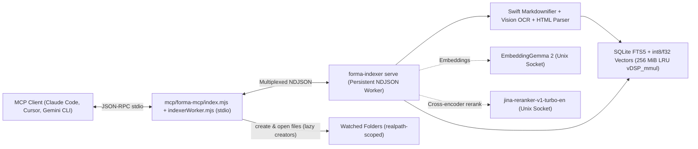

# Forma MCP

Forma MCP connects a local assistant to the same index used by the Forma Start Hub and ⌘K search. The stdio server delegates each index operation to `forma-indexer`. Native Swift Markdown extraction, Apple Vision OCR, **EmbeddingGemma 2**, and **`jina-reranker-v1-turbo-en`** cross-encoder reranking all run locally on the Mac.

The MCP server starts a persistent `forma-indexer serve` worker on its first request. Searches reuse the worker's model processes and vector cache until idle shutdown or disconnect; folder access is checked on each request. Older binaries and test stubs fall back to one-shot CLI calls. Set `FORMA_MCP_PERSISTENT=0` to use one-shot calls explicitly. Creator libraries load only when a create tool is used.

The matrix cache retains at most 256 MiB by estimated size; a matrix larger than that is searched but not cached. Search and read requests have a two-minute deadline, status and folder requests 30 seconds, and index/sync requests 30 minutes. A deadline resets the worker and reports an error to other in-flight requests; an explicit cancellation only removes that request's waiter.



Run these commands from the Forma repository.

```sh
npm ci
npm run setup:embed
npm run build:mac
npm run mac:install-indexer
```

Forma reconciles the watched folders on login and daily at 02:00 local time. Between scans, macOS file-change events queue updates for affected files and subfolders. Forma checks modification time, file size, and the embedding model before extracting content. Backfills start with the newest files and rotate through the watched folders. The model starts when indexing needs it and shuts down after the worker idles.

Add or remove watched folders from **Indexed Folders** in the Start Hub or ⌘K. Adding a folder queues a catch-up pass. Removing a watched folder removes its indexed entries when no remaining root covers them. The index and configuration live in `~/Library/Application Support/FormaOffice`. Set `FORMA_INDEX_INTERVAL_SECONDS` at install time for additional reconciliation runs. `npm run mac:uninstall-indexer` stops both background jobs and preserves the index.

## Register the stdio server

Run the following commands from the repository root. Use an absolute Node executable path if your client launches with a restricted PATH.

**Claude Code**

```sh
claude mcp add --transport stdio forma -- node "$PWD/mcp/forma-mcp/index.mjs"
```

**Other MCP Clients (Cursor, Gemini CLI, etc.)**

Add the `forma` entry under `mcpServers` in your MCP client configuration file. Replace the example path with the absolute path to this checkout.

```json
{
  "mcpServers": {
    "forma": {
      "command": "node",
      "args": ["/absolute/path/to/forma-office/mcp/forma-mcp/index.mjs"]
    }
  }
}
```

## Tools

| Tool | Use |
| --- | --- |
| `forma_search` | Find ranked text and visual matches using SQLite FTS5 + `int8`/`float32` `vDSP_mmul` vectors + `jina-reranker-v1-turbo-en` reranking (`matchType: "reranked"` / `"hybrid"`). Optionally filter by kind or limit. |
| `forma_read` | Read an indexed document by ID or a supported file inside a watched folder as structured Markdown (headings, lists, and pipe tables for `.docx`, `.odt`, `.xlsx`, `.ods`, `.html`). Automatically runs Vision OCR on sparse PDFs; set `ocr: true` to scan up to 60 pages without text. |
| `forma_index` | Sync watched folders or index a file or subfolder inside one. Set `force` to reindex unchanged files. |
| `forma_status` | View index counts, watched folders, `embedModel`, `rerankerReady` / `rerankModel`, and the last completed sync time. |
| `forma_folders` | List watched folders. Manage watched folders in Forma or through the local CLI. |
| `forma_open` | Open a file in a watched folder in its native Forma app. |
| `forma_create_canvas` | Create a `.fcanvas` or `.excalidraw` diagram inside a watched folder from a Mermaid flowchart (`mermaid`) or starter template (`blank`, `architecture`, `mindmap`, `kanban`). Optionally set `open: true` to launch in Forma Canvas. |
| `forma_create_sheet` | Create a `.xlsx` or `.csv` spreadsheet inside a watched folder from structured `sheets` (`name` + `rows`). Cell strings starting with `=` are written as Excel formulas with styled headers and auto-sized columns. Optionally set `open: true` to launch in Forma Sheets. |
| `forma_create_slides` | Create a 16:9 `.pptx` presentation inside a watched folder from structured `slides` (`title`, `subtitle`, `bullets`, `notes`) with `light`, `dark`, or `ocean` theme. Optionally set `open: true` to launch in Forma Slides. |
| `forma_create_doc` | Create a `.docx` or `.md` document inside a watched folder from Markdown (`headings`, bullet/numbered lists, fenced code blocks, and pipe tables). Optionally set `open: true` to launch in Forma Docs. |

All `forma_create_*` tools enforce the same watched-folder boundary as `forma_read` and `forma_open` (existing non-hidden parent directory inside a watched folder, non-hidden filename, and no symlink overwrites) and automatically trigger a best-effort index update so newly created files are immediately searchable.

For a trusted local MCP client that manages folder access, set `FORMA_MCP_ALLOW_FOLDER_CHANGES=1` in its server environment to enable `add` and `remove`.

The first full sync may take longer than a client’s default tool timeout. Start it from **Sync Now** in Forma or run `"$HOME/Library/Application Support/FormaOffice/bin/forma-indexer" sync --json`.

## Verify the installation

```sh
npx tsc -b
npm test -- --run
node scripts/verify-indexer.mjs
node scripts/verify-index-watcher.mjs
node scripts/benchmark-forma-mcp.mjs
```

The verification scripts use temporary fixtures and the embedded runtime with Ollama disabled. They cover Office, PDF, notebook and Canvas indexing, MCP over stdio, fair backfill order, and file and folder changes while the watcher is running or offline.
The benchmark reads the live index, uses isolated model sockets, checks cache reuse and concurrent cold misses, and verifies that its worker and model processes exit on disconnect. Its default quality check expects the Gamma Distribution Explorer file; set `FORMA_BENCH_QUERY` and `FORMA_BENCH_EXPECT` to a query and expected title or path for a different index.
